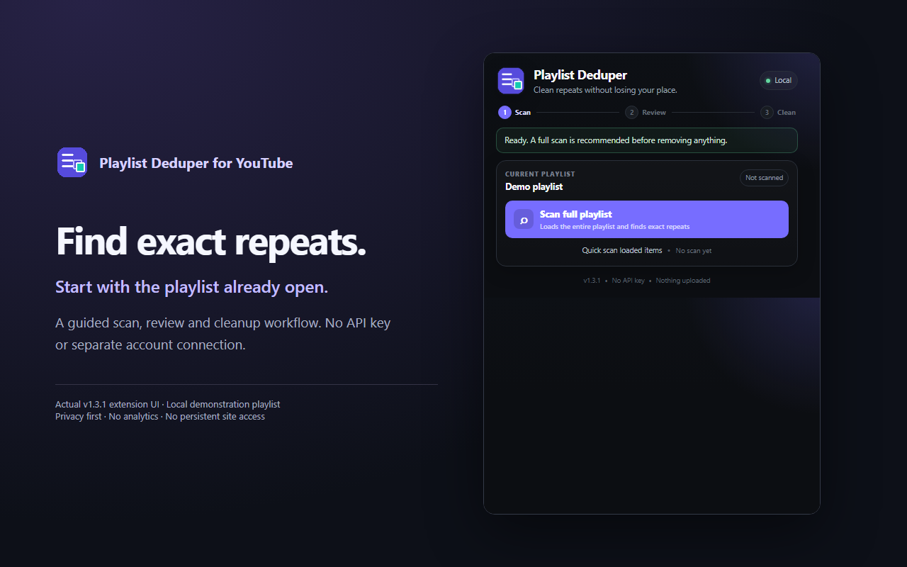
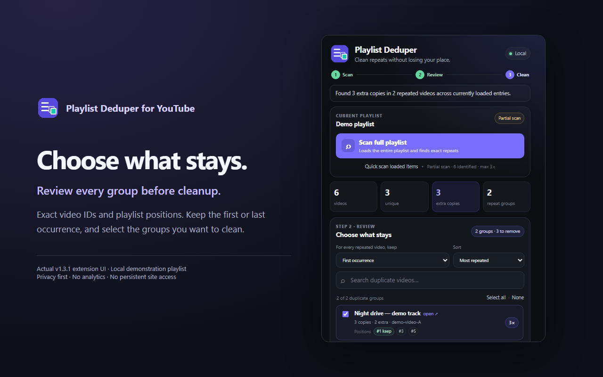
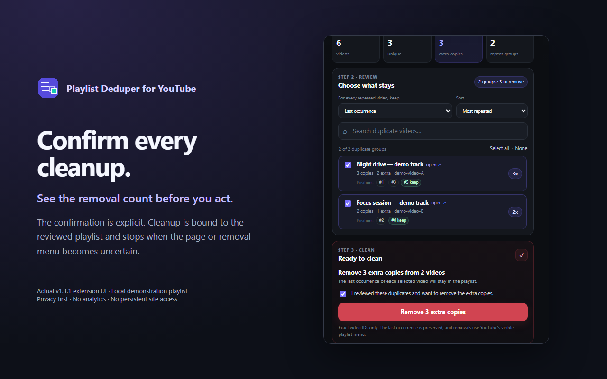

# Playlist Deduper for YouTube™

A privacy-first Chrome/Chromium extension for finding, reviewing, and safely removing **exact duplicate video entries** from editable YouTube playlists.

> **Status:** v1.3.1 release candidate · live Chrome regression pending · Manifest V3 · source-available for non-commercial use

## Why this exists

Large YouTube playlists are easy to accumulate over months or years, and repeated saves can quietly create dozens of duplicates. Manually finding them is slow, while one-click cleanup scripts can be risky because they may act on the wrong menu item or remove the wrong occurrence.

Playlist Deduper takes a deliberately review-first approach:

**Scan → Review → Clean → Verify**

It matches duplicates by **YouTube video ID**, shows their playlist positions, lets you choose exactly which groups to clean, and refuses to guess if YouTube's current interface cannot be identified safely.

## Highlights

- Exact duplicate detection by **video ID**, never fuzzy title matching.
- Lazy-loading scan for long playlists; incomplete scans are labelled partial.
- Fast scan of entries already loaded in the page.
- Duplicate groups with exact **playlist positions**.
- Selective cleanup: clean all groups or only the ones you choose.
- Choose **keep first** or **keep last** occurrence.
- Search and sort by repeat count, playlist order, or title.
- Copy a human-readable report or export CSV.
- Diagnostics for private/deleted/unidentified placeholders.
- Explicit confirmation before any playlist modification.
- Rate-limited and cancellable cleanup.
- Post-action verification to confirm the DOM count actually changed.
- No YouTube Data API key, OAuth flow, analytics, backend, or playlist-data upload.
- No persistent YouTube host permission.

## Get it

**Candidate downloads (available publicly after publication):** [v1.3.1 offline ZIP](https://github.com/wayri/Playlist-De-duplicator-for-Youtube/releases/download/v1.3.1/playlist-deduper-for-youtube-v1.3.1-offline.zip) — extract it and load the included `Playlist-Deduper-for-YouTube` folder from `chrome://extensions`. The [Store ZIP](https://github.com/wayri/Playlist-De-duplicator-for-Youtube/releases/download/v1.3.1/playlist-deduper-for-youtube-v1.3.1-store.zip) and [source ZIP](https://github.com/wayri/Playlist-De-duplicator-for-Youtube/releases/download/v1.3.1/playlist-deduper-for-youtube-v1.3.1-source.zip) will be attached alongside SHA-256 checksums. Until the live regression gate passes, v1.3.1 remains a draft. The [latest published baseline is v1.3.0](https://github.com/wayri/Playlist-De-duplicator-for-Youtube/releases/tag/v1.3.0).

[Full installation, update, and uninstall guide](docs/INSTALLATION.md) · [User guide](docs/USER_GUIDE.md) · [Troubleshooting](docs/TROUBLESHOOTING.md)

> Chrome Web Store submission is pending. Until it is approved, the GitHub offline package uses Chrome's standard **Load unpacked** flow.

## Screenshots

Actual extension UI with a local test playlist fixture; not a live account capture.





## Install locally

### From a release ZIP

1. Download the latest **`*-offline.zip`** from [GitHub Releases](https://github.com/wayri/Playlist-De-duplicator-for-Youtube/releases/latest).
2. Extract it to a permanent folder.
3. Open `chrome://extensions`.
4. Enable **Developer mode**.
5. Click **Load unpacked**.
6. Select the extracted `Playlist-Deduper-for-YouTube` folder containing `manifest.json`.
7. Pin **Playlist Deduper** from Chrome's extensions menu.
8. Open a YouTube playlist you can edit and click the extension.

### From a clone

```bash
git clone https://github.com/wayri/Playlist-De-duplicator-for-Youtube.git
cd Playlist-De-duplicator-for-Youtube
```

Then use **Load unpacked** and select the cloned repository directory.

No build step and no package installation are required for the extension itself.

## Basic usage

1. Open the dedicated playlist page: `youtube.com/playlist?list=...`.
2. Click **Scan full playlist**.
3. Review duplicate cards and their positions.
4. Search/sort if useful and deselect any groups you want untouched.
5. Choose **Keep first** or **Keep last**.
6. Review the exact removal count.
7. Tick the confirmation checkbox.
8. Click **Remove selected duplicates**.
9. Keep the YouTube tab open until verification completes.

For a detailed walkthrough, see [`docs/USER_GUIDE.md`](docs/USER_GUIDE.md). For installation/update details, see [`docs/INSTALLATION.md`](docs/INSTALLATION.md).

## Safety model

The extension does **not** call a private YouTube deletion endpoint. It operates the visible playlist-item menu in the currently open page.

Cleanup is bound to the reviewed playlist and scan snapshot. Operations are locked while active; stale context, a changed survivor, or an ambiguous menu causes cleanup to stop. Before clicking a destructive menu command, it accepts only the English exact commands “Remove from playlist” or “Remove from <current playlist title>”. If the command cannot be recognized confidently, the extension closes/abandons that action and reports a failure instead of guessing.

Full scans rely on page loading heuristics and may be incomplete; review any partial-scan warning. Current live Chrome regression testing remains pending; see [release evidence](docs/releases/v1.3.1-evidence.md).

Read the full model in [`docs/SECURITY_MODEL.md`](docs/SECURITY_MODEL.md).

## Privacy and permissions

The manifest requests only:

| Permission | Why it is needed |
| --- | --- |
| `activeTab` | Temporary access to the tab where the user explicitly invokes the extension. |
| `scripting` | Injects the packaged `content.js` helper into that temporarily authorized tab. |
| `storage` | Stores local UI preferences such as keep-first/keep-last and sort order. |

The extension does **not** request persistent `youtube.com` host access.

Playlist contents and scan results are processed locally and are not uploaded to the developer or a third party. There is no analytics SDK, ad SDK, remote executable code, OAuth integration, or YouTube API key.

See [`PRIVACY_POLICY.md`](PRIVACY_POLICY.md) and [`docs/PRIVACY_AND_PERMISSIONS.md`](docs/PRIVACY_AND_PERMISSIONS.md).

## Project structure

```text
.
├── manifest.json                Chrome Manifest V3 declaration
├── popup.html/.css/.js          Guided popup UI and user interaction
├── content.js                   YouTube page scan/load/remove logic
├── icons/                       Extension icons
├── docs/                        User, architecture, development and release docs
├── scripts/                     Local validation/package helpers
├── .github/                     CI, issue templates and PR template
├── PRIVACY_POLICY.md            Public privacy statement
├── STORE_LISTING.md             Chrome Web Store listing draft
├── TEST_PLAN.md                 Manual regression checklist
├── CHANGELOG.md                 Release history
├── LICENSE.md                   Code/content license scope
└── NOTICE.md                    Copyright and trademark notices
```

## Development

This project intentionally uses plain HTML/CSS/JavaScript and has no runtime framework or dependency chain.

Run static validation with:

```bash
npm test
```

or directly:

```bash
node scripts/validate.mjs
```

See [`docs/DEVELOPMENT.md`](docs/DEVELOPMENT.md) and [`docs/ARCHITECTURE.md`](docs/ARCHITECTURE.md).

## Compatibility warning

YouTube is a frequently changing single-page application. DOM selectors, menu structure, or localized action text can change without notice. A YouTube UI change can therefore break scanning or cleanup even if the extension itself has not changed.

When this happens, the intended behavior is to **fail closed** on destructive actions. See [`docs/SELECTORS_AND_COMPATIBILITY.md`](docs/SELECTORS_AND_COMPATIBILITY.md) and [`docs/TROUBLESHOOTING.md`](docs/TROUBLESHOOTING.md).

## Roadmap

Near-term work is intentionally kept inside the extension's single purpose: duplicate discovery, review, cleanup, and safety. Planned/considered improvements are tracked in [`docs/ROADMAP.md`](docs/ROADMAP.md).

## Contributing

Bug reports and carefully scoped improvements are welcome. Please read [`CONTRIBUTING.md`](CONTRIBUTING.md) before opening a pull request, especially the rules around destructive-action safety and permissions.

## Security

Do not publish a security-sensitive report in a public issue if it could expose users to unintended playlist modification or code execution. See [`SECURITY.md`](SECURITY.md).

## Licensing

This repository is **source-available**, not OSI-approved open source:

- Software code: **PolyForm Noncommercial 1.0.0**.
- Documentation and original media: **CC BY-NC 4.0**.

Commercial use is not granted by the repository license. See [`LICENSE.md`](LICENSE.md).

## Trademark notice

YouTube is a trademark of Google LLC. Playlist Deduper for YouTube™ is an independent project and is not affiliated with, endorsed by, sponsored by, or maintained by Google LLC or YouTube.
